# Order Flow Observability Demo

Standalone synthetic observability demo with a fictional order-placement flow:
a .NET 10 Order API, in-memory worker, fake fulfillment service, React UI,
OpenTelemetry instrumentation, local Grafana LGTM stack, and optional bounded
JMeter plan. It requires no cloud account, company system, credentials, or real
customer data.

## Contents

- [Architecture](#architecture)
- [Requirements](#requirements)
- [Build](#build)
- [Run locally](#run-locally)
- [Podman stack](#podman-stack)
- [Health and reset](#health-and-reset)
- [Test plan](TEST-PLAN.md)
- [WebUI guide](web/docs/ui-guide.md)

## Architecture

```mermaid
classDiagram
    direction LR

    class WebUI["WebUI (web)"] {
        React order form
        Submits orders and polls status
    }
    class OrderAPI["OrderAPI (Demo.JourneyApi)"] {
        Create and query orders
        Forwards requests to worker
    }
    class Worker["Worker (Demo.Worker)"] {
        Bounded in-memory queue
        In-memory order status
        Background order processor
    }
    class Fulfillment["Fulfillment (Demo.Dependency)"] {
        Configurable healthy, slow, failing scenarios
    }
    class ServiceDefaults["ServiceDefaults (Demo.ServiceDefaults)"] {
        Shared OpenTelemetry configuration
        Exports traces, metrics, and logs over OTLP
    }
    class OrderTelemetry["OrderTelemetry (Demo.ServiceDefaults)"] {
        Order duration and outcome metrics
        Worker queue and active worker metrics
    }
    class OTelLGTM["OTelLGTM (compose.yaml)"] {
        OTLP ingestion
        Grafana, Loki, Tempo, Prometheus
    }
    class GrafanaDashboard["GrafanaDashboard (grafana/dashboards)"] {
        Provisioned Order Flow dashboard
    }
    class JMeter["JMeter (load)"] {
        Optional load profile
        Capped at 80 synthetic orders
    }

    WebUI --> OrderAPI : HTTP
    OrderAPI --> Worker : submit and query
    Worker --> Fulfillment : process items
    OrderAPI ..> ServiceDefaults : telemetry
    Worker ..> ServiceDefaults : telemetry
    Fulfillment ..> ServiceDefaults : telemetry
    ServiceDefaults ..> OrderTelemetry : collects custom metrics
    ServiceDefaults --> OTelLGTM : OTLP export
    OTelLGTM --> GrafanaDashboard : provisions
    JMeter ..> OrderAPI : optional HTTP load
```



## Requirements

- .NET SDK 10.0.403 (selected by `global.json`)
- PowerShell

`NuGet.Config` clears inherited package feeds and uses nuget.org only.

## Build

From this directory:

```powershell
dotnet restore Demo.sln --configfile NuGet.Config
dotnet build Demo.sln --no-restore
```

## Run locally

Open three PowerShell terminals in this directory for the services.

Terminal 1, fake fulfillment service (project `Demo.Dependency`):

```powershell
dotnet run --no-build --project .\Demo.Dependency\Demo.Dependency.csproj --urls http://127.0.0.1:8082
```

Terminal 2, worker:

```powershell
$env:FULFILLMENT_URL = 'http://127.0.0.1:8082'
dotnet run --no-build --project .\Demo.Worker\Demo.Worker.csproj --urls http://127.0.0.1:8081
```

Terminal 3, Order API (project `Demo.JourneyApi`):

```powershell
$env:WORKER_URL = 'http://127.0.0.1:8081'
dotnet run --no-build --project .\Demo.JourneyApi\Demo.JourneyApi.csproj --urls http://127.0.0.1:8080
```

All endpoints bind to loopback. With the three services running, execute:

```powershell
.\scripts\smoke.ps1
```

The smoke script checks all health endpoints, then exercises healthy, slow, and
failing order submissions. Stop each service with Ctrl+C. OpenTelemetry OTLP
export is wired to `OTEL_EXPORTER_OTLP_ENDPOINT`. To run the React UI locally,
open another terminal in `web/` and run `npm run dev`; open
`http://127.0.0.1:5173/`.
Custom metrics export every 10 seconds so the dashboard responds quickly during
the walkthrough.

## Podman stack

Install the Compose provider into a local Python virtual environment once:

```powershell
py -m venv .venv
.\.venv\Scripts\python -m pip install podman-compose
$env:PATH = "$PWD\.venv\Scripts;$env:PATH"
$env:PODMAN_COMPOSE_PROVIDER = "$PWD\.venv\Scripts\podman-compose.exe"
```

Then start the Podman machine and run the stack from this directory:

```powershell
podman machine start
$env:PATH = "$PWD\.venv\Scripts;$env:PATH"
$env:PODMAN_COMPOSE_PROVIDER = "$PWD\.venv\Scripts\podman-compose.exe"
podman compose config
podman compose up --build
```

Open the UI at `http://127.0.0.1:5173/` and Grafana at
`http://127.0.0.1:3000/`. All published ports bind to loopback. Switch the fake
fulfillment service with `.\scripts\set-scenario.ps1 -Name slow` (replace `slow` with
`healthy` or `failing`).

For the optional load profile, first set fulfillment to `slow`, then run the
JMeter scenario capped at 80 synthetic orders:

```powershell
.\scripts\set-scenario.ps1 -Name slow
podman compose --profile load run --rm jmeter
```

The stack is running and has been smoke-tested. Grafana is at
`http://127.0.0.1:3000/`; the Order Flow dashboard is provisioned on startup.
The LGTM Prometheus config scrapes every five seconds, and the .NET metric
exporter flushes every ten seconds so short load spikes are visible.

## Health and reset

With Compose running, verify the service endpoints:

```powershell
Invoke-RestMethod http://127.0.0.1:8080/health
Invoke-RestMethod http://127.0.0.1:8081/health
Invoke-RestMethod http://127.0.0.1:8082/health
Invoke-RestMethod http://127.0.0.1:3000/api/health
```

Stop containers while preserving telemetry data:

```powershell
podman compose down
```

For a full clean reset, which deletes only this demo's local telemetry volume:

```powershell
podman compose down --volumes
podman compose up -d
```

For an offline start after the images and dependencies are cached, use
`podman compose up -d` without `--build`. The fully disconnected start has not
been tested yet. Set fulfillment back to `healthy` before stopping if it was
left in `slow` or `failing` mode.
