# Order Flow Observability Demo

Standalone synthetic observability demo with a fictional order-placement flow:
a .NET 10 Order API, in-memory worker, fake fulfillment service, React UI,
OpenTelemetry instrumentation, local Grafana LGTM stack, and optional bounded
JMeter plan. It requires no cloud account, company system, credentials, or real
customer data.

## Contents

- [Architecture](#architecture)
- [Requirements](#requirements)
- [Build](#build)
- [Run locally](#run-locally)
- [Podman stack](#podman-stack)
- [Host ports and where services run](#host-ports-and-where-services-run)
- [Health and reset](#health-and-reset)
- [Test plan](TEST-PLAN.md)
- [WebUI guide](web/docs/ui-guide.md)

## Architecture

```mermaid
classDiagram
    direction LR

    class WebUI["WebUI (web)"] {
        React order form
        Submits orders and polls status
    }
    class OrderAPI["OrderAPI (Demo.JourneyApi)"] {
        Create and query orders
        Forwards requests to worker
    }
    class Worker["Worker (Demo.Worker)"] {
        Bounded in-memory queue
        In-memory order status
        Background order processor
    }
    class Fulfillment["Fulfillment (Demo.Dependency)"] {
        Configurable healthy, slow, failing scenarios
    }
    class ServiceDefaults["ServiceDefaults (Demo.ServiceDefaults)"] {
        Shared OpenTelemetry configuration
        Exports traces, metrics, and logs over OTLP
    }
    class OrderTelemetry["OrderTelemetry (Demo.ServiceDefaults)"] {
        Order duration and outcome metrics
        Worker queue and active worker metrics
    }
    class OTelLGTM["OTelLGTM (compose.yaml)"] {
        OTLP ingestion
        Grafana, Loki, Tempo, Prometheus
    }
    class GrafanaDashboard["GrafanaDashboard (grafana/dashboards)"] {
        Provisioned Order Flow dashboard
    }
    class JMeter["JMeter (load)"] {
        Optional load profile
        Capped at 80 synthetic orders
    }

    WebUI --> OrderAPI : HTTP
    OrderAPI --> Worker : submit and query
    Worker --> Fulfillment : process items
    OrderAPI ..> ServiceDefaults : telemetry
    Worker ..> ServiceDefaults : telemetry
    Fulfillment ..> ServiceDefaults : telemetry
    ServiceDefaults ..> OrderTelemetry : collects custom metrics
    ServiceDefaults --> OTelLGTM : OTLP export
    OTelLGTM --> GrafanaDashboard : provisions
    JMeter ..> OrderAPI : optional HTTP load
```



## Requirements

- .NET SDK 10.0.403 (selected by `global.json`)
- PowerShell

`NuGet.Config` clears inherited package feeds and uses nuget.org only.

## Build

From this directory:

```powershell
dotnet restore Demo.sln --configfile NuGet.Config
dotnet build Demo.sln --no-restore
```

## Run locally

Open three PowerShell terminals in this directory for the services.

Terminal 1, fake fulfillment service (project `Demo.Dependency`):

```powershell
dotnet run --no-build --project .\Demo.Dependency\Demo.Dependency.csproj --urls http://127.0.0.1:8082
```

Terminal 2, worker:

```powershell
$env:FULFILLMENT_URL = 'http://127.0.0.1:8082'
dotnet run --no-build --project .\Demo.Worker\Demo.Worker.csproj --urls http://127.0.0.1:8081
```

Terminal 3, Order API (project `Demo.JourneyApi`):

```powershell
$env:WORKER_URL = 'http://127.0.0.1:8081'
dotnet run --no-build --project .\Demo.JourneyApi\Demo.JourneyApi.csproj --urls http://127.0.0.1:8080
```

All endpoints bind to loopback. With the three services running, execute:

```powershell
.\scripts\smoke.ps1
```

The smoke script checks all health endpoints, then exercises healthy, slow, and
failing order submissions. Stop each service with Ctrl+C. OpenTelemetry OTLP
export is wired to `OTEL_EXPORTER_OTLP_ENDPOINT`. To run the React UI locally,
open another terminal in `web/` and run `npm run dev`; open
`http://127.0.0.1:5173/`.
Custom metrics export every 10 seconds so the dashboard responds quickly during
the walkthrough.

## Podman stack

Install the Compose provider into a local Python virtual environment once:

```powershell
py -m venv .venv
.\.venv\Scripts\python -m pip install podman-compose
$env:PATH = "$PWD\.venv\Scripts;$env:PATH"
$env:PODMAN_COMPOSE_PROVIDER = "$PWD\.venv\Scripts\podman-compose.exe"
```

Then start the Podman machine and run the stack from this directory:

```powershell
podman machine start
$env:PATH = "$PWD\.venv\Scripts;$env:PATH"
$env:PODMAN_COMPOSE_PROVIDER = "$PWD\.venv\Scripts\podman-compose.exe"
podman compose config
podman compose up --build
```

Open the UI at `http://127.0.0.1:5173/` and Grafana at
`http://127.0.0.1:3000/`. All published ports bind to loopback. Switch the fake
fulfillment service with `.\scripts\set-scenario.ps1 -Name slow` (replace `slow` with
`healthy` or `failing`).

For the optional load profile, first set fulfillment to `slow`, then run the
JMeter scenario capped at 80 synthetic orders:

```powershell
.\scripts\set-scenario.ps1 -Name slow
podman compose --profile load run --rm jmeter
```

The stack is running and has been smoke-tested. Grafana is at
`http://127.0.0.1:3000/`; the Order Flow dashboard is provisioned on startup.
The LGTM Prometheus config scrapes every five seconds, and the .NET metric
exporter flushes every ten seconds so short load spikes are visible.

## Host ports and where services run

`127.0.0.1` means this machine's loopback interface. It tells you where to
connect, **not** whether the service is a Windows process or a container.
That depends on how you started the demo.

### Podman Compose mode

When started with `podman compose up --build`, all services below run in
containers, not as host `dotnet` or npm processes. On Windows, Podman runs the
Linux containers inside the Podman machine and forwards their published ports
to the Windows host. This is the mode used for the recorded ND-2 health checks.

The mappings come from [compose.yaml](compose.yaml). For example,
`127.0.0.1:5173:80` means host port **5173** forwards to port **80** in the
`web` container:

| Host address / port | Container destination | What lives there | Why connect |
|---|---|---|---|
| <http://127.0.0.1:5173/> | `web:80` | Nginx serving the built React **WebUI**, with `/api/` proxied to the Order API. No Vite/npm development server runs here in Compose mode. | Open in a browser to place synthetic orders and read the latest result. |
| <http://127.0.0.1:8080/> | `order-api:8080` | .NET **Order API**: `POST /orders`, `GET /orders/{orderId}`, and `GET /health`. | Submit/query orders directly or check API health. API endpoints, not a separate user-facing page. |
| <http://127.0.0.1:8081/> | `worker:8080` | .NET **worker**: `POST /work`, `GET /work/{orderId}`, and `GET /health`; in-memory queue and order storage. | Check worker health or diagnose work submission/status directly. Normal UI traffic goes through the Order API. |
| <http://127.0.0.1:8082/> | `fulfillment:8080` | .NET **fake fulfillment**: `POST /process`, `POST /scenario`, and `GET /health`. | Check health or switch healthy/slow/failing behavior using the scenario scripts. |
| <http://127.0.0.1:3000/> | `otel-lgtm:3000` | **Grafana UI**, including Explore, the Order Flow dashboard, and `/api/health`. | Open in a browser to investigate traces/logs and view metrics, or call the health endpoint. This is not the order WebUI. |
| `127.0.0.1:4317` | `otel-lgtm:4317` | **OpenTelemetry Collector OTLP/gRPC ingestion**. | Configure a compatible telemetry exporter to send data here; not a browser page. |
| `http://127.0.0.1:4318` | `otel-lgtm:4318` | **OpenTelemetry Collector OTLP/HTTP ingestion** for traces, metrics, and logs. | Configure an OTLP/HTTP exporter to send data here; not a browser page. Containerized .NET services use this protocol internally. |

The three .NET containers can all listen on port `8080` because each has its
own container network namespace. Their host ports differ so you can access
them separately.

Inside the Compose network, services use container names and internal ports,
such as `http://worker:8080`, `http://fulfillment:8080`, and
`http://otel-lgtm:4318`. They do not use the host's forwarded ports for these
calls. `127.0.0.1` inside a container refers to that container, not Windows.

All published ports bind to host loopback, not all network interfaces. Ports
shown by `podman compose ps` without a host mapping (for example `3200/tcp`,
`4040/tcp`, or `9090/tcp` in the LGTM image) are not published to Windows by this
Compose configuration. Access the telemetry backends through Grafana. The
optional JMeter container publishes no host port; it sends requests to the API
on the Compose network.

### Direct host development mode

**Optional alternative, not an additional setup step.** Skip this mode when
running the demo entirely with Podman. Use it when you want to run or debug
the application processes directly on Windows without rebuilding their images.

The commands in [Run locally](#run-locally) start the application services
directly on Windows instead:

| Host port | Direct host process | Difference from Compose |
|---|---|---|
| `5173` | `npm run dev` starts the Vite development server in `web/`. | Vite serves React and proxies `/api/` to `127.0.0.1:8080`; there is no Nginx container in this path. |
| `8080` | `dotnet run` for `Demo.JourneyApi` | The Order API listens directly on the host. |
| `8081` | `dotnet run` for `Demo.Worker` | The worker listens directly on the host. |
| `8082` | `dotnet run` for `Demo.Dependency` | Fake fulfillment listens directly on the host. |

Those host commands do **not** start Grafana or an OTLP collector. Ports
`3000`, `4317`, and `4318` are available only if you separately run the telemetry
stack or another compatible service. To export from host-run .NET services to
the Podman LGTM collector, set these variables in each service's terminal
before starting it:

```powershell
$env:OTEL_EXPORTER_OTLP_ENDPOINT = 'http://127.0.0.1:4318'
$env:OTEL_EXPORTER_OTLP_PROTOCOL = 'http/protobuf'
```

Do not run the full Compose stack and the direct host applications on the same
ports simultaneously. Stop the competing services or deliberately reconfigure
their ports and downstream URLs first. `dotnet build` and `npm run build` only
produce build output; neither command starts a listening server.

To see container-owned host mappings, run `podman compose ps` or `podman port
<container-name>`. To inspect Windows listeners for this demo:

```powershell
Get-NetTCPConnection -State Listen |
    Where-Object { $_.LocalPort -in 5173, 8080, 8081, 8082, 3000, 4317, 4318 } |
    Select-Object LocalAddress, LocalPort, OwningProcess
```

Use `Get-Process -Id <OwningProcess>` to identify a listener. For Podman
forwarding, the Windows process may be a networking/forwarding process rather
than the actual application; use the Compose mappings to identify its service.

## Health and reset

With Compose running, verify the service endpoints:

```powershell
Invoke-RestMethod http://127.0.0.1:8080/health
Invoke-RestMethod http://127.0.0.1:8081/health
Invoke-RestMethod http://127.0.0.1:8082/health
Invoke-RestMethod http://127.0.0.1:3000/api/health
```

Stop containers while preserving telemetry data:

```powershell
podman compose down
```

For a full clean reset, which deletes only this demo's local telemetry volume:

```powershell
podman compose down --volumes
podman compose up -d
```

For an offline start after the images and dependencies are cached, use
`podman compose up -d` without `--build`. The fully disconnected start has not
been tested yet. Set fulfillment back to `healthy` before stopping if it was
left in `slow` or `failing` mode.
