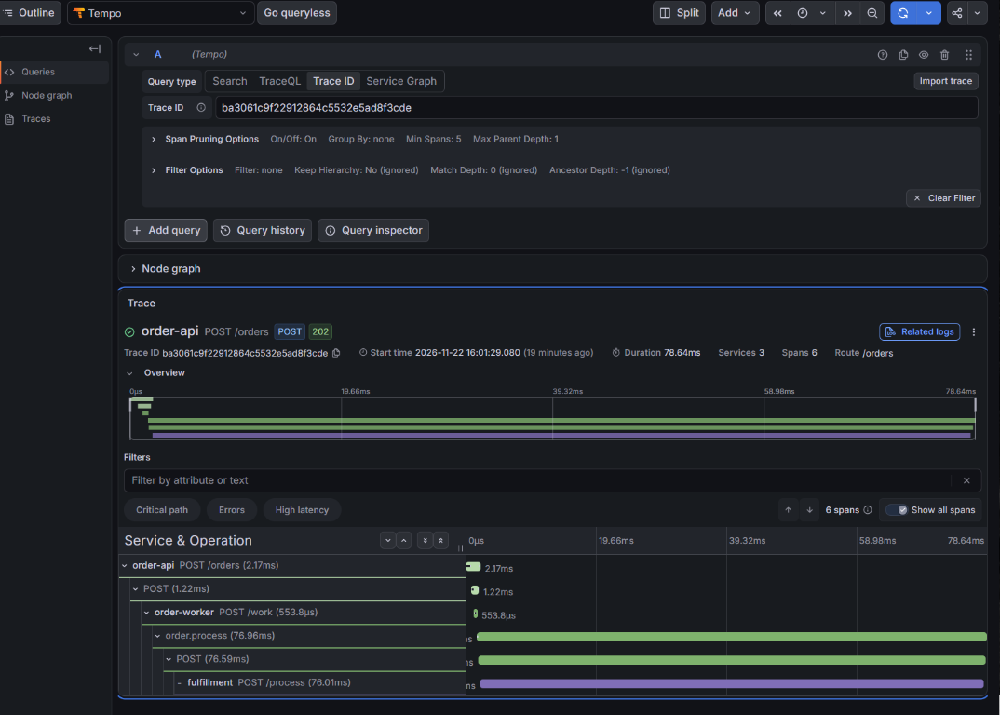
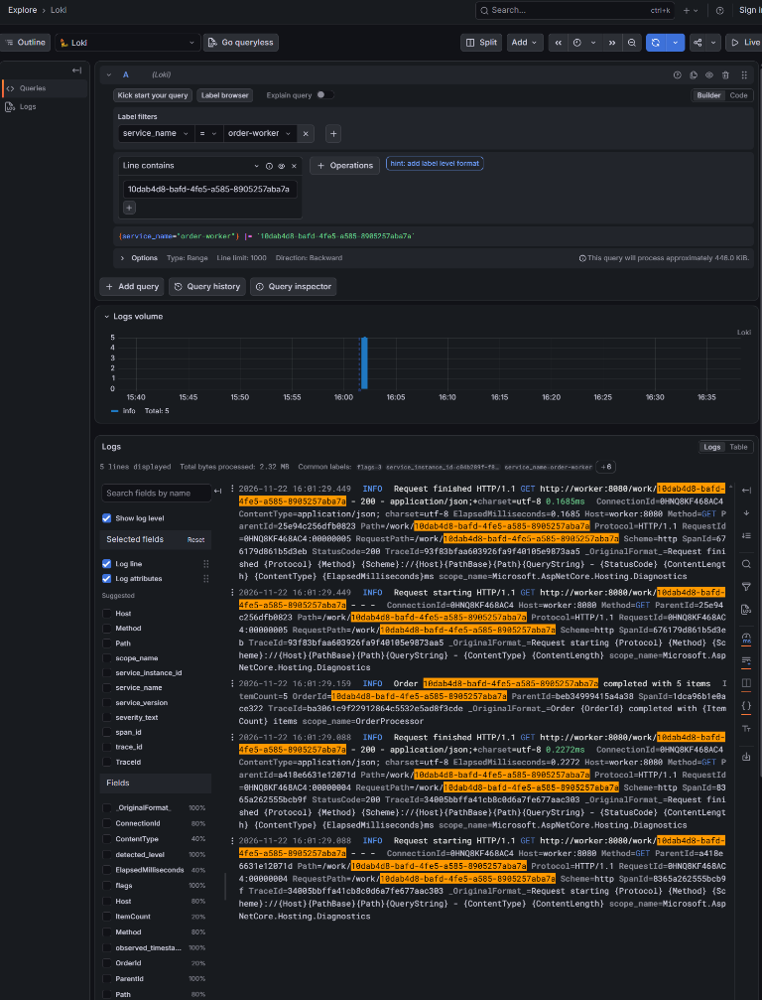
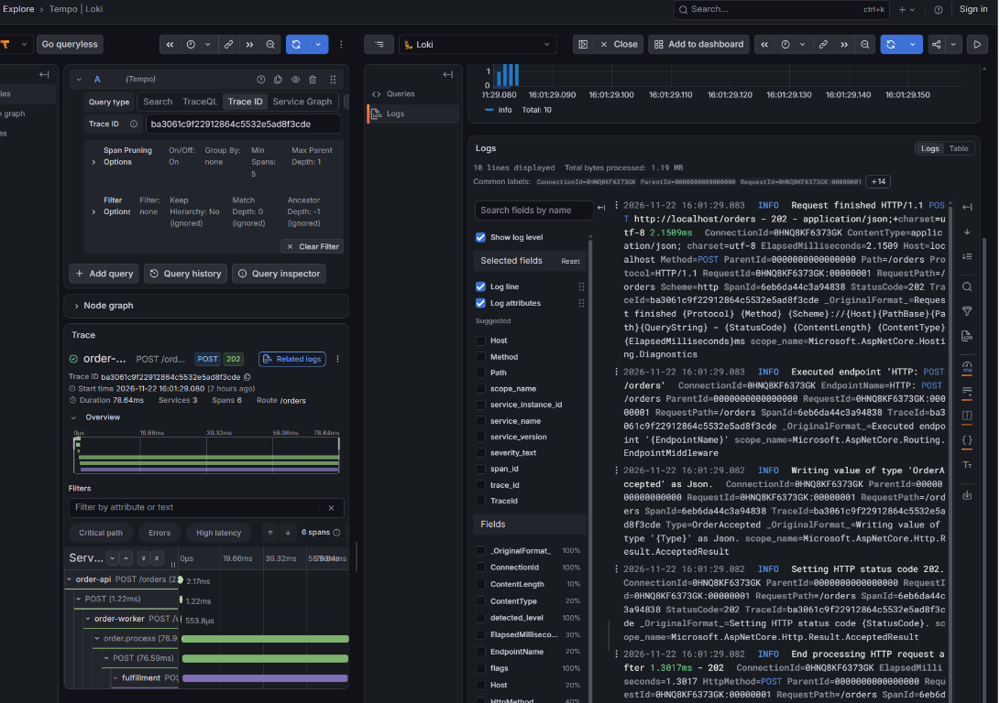

# How to Read Grafana

This guide follows one synthetic order through the local Grafana stack. Start
the demo stack first; the order UI is at <http://127.0.0.1:5173/> and Grafana
is at <http://127.0.0.1:3000/>.

## Contents

- [Find an order trace](#find-an-order-trace)
- [Read the example trace](#read-the-example-trace)
- [Find the matching log](#find-the-matching-log)
- [Read the example Loki results](#read-the-example-loki-results)
- [Filter logs for a specific span](#filter-logs-for-a-specific-span)
- [Read the Order Flow dashboard](#read-the-order-flow-dashboard)
- [Understand order duration p95](#understand-order-duration-p95)
- [How order metrics reach Prometheus](#how-order-metrics-reach-prometheus)
- [If data is missing](#if-data-is-missing)

## Find an order trace

1. From the repository root, set fulfillment to the healthy scenario:

   ```powershell
   .\scripts\set-scenario.ps1 -Name healthy
   ```

2. Place an order in the UI and copy both its **Trace ID** and **Order ID**.
   The trace ID identifies the submission trace; the order ID identifies the
   order and helps locate its worker log.
3. Open Grafana, select **Explore**, and choose **Tempo** as the data source.
4. Select the **Trace ID** query type, paste the trace ID into its field, and
   run the query with the blue button at the top right.

## Read the example trace



The screenshot shows a trace found successfully by its ID. Its values are an
example, not thresholds your own order must match.

- **Trace summary:** `order-api POST /orders`, `202`, **3 services**, and
  **6 spans**. A trace groups related operations; each span represents one
  operation. HTTP `202 Accepted` means the order was accepted for processing,
  not that fulfillment already completed.
- **Duration 78.64 ms:** the time covered by this trace in the screenshot.
  The root `POST /orders` span took only 2.17 ms; the background work continued
  after the API accepted the order. The UI's final duration can be longer
  because it includes browser communication and status-polling delay.
- **Service & Operation:** read the indented rows as parent/child relationships.
  `order-api POST /orders` receives the request and forwards work;
  `order-worker POST /work` accepts it; `order.process` is the worker's
  background processing; the nested `POST` calls fulfillment, and
  `fulfillment POST /process` handles that call.
- **Timeline bars:** the horizontal position shows when a span started relative
  to the trace; its length shows how long it lasted. The long fulfillment bar
  is about 76 ms here, accounting for most of this trace's elapsed time.
  Nested spans overlap, so do not add their durations together.
- **Expand a row** to inspect its attributes and timing. For example, the
  `order.process` span includes `order.id` and `item.count` attributes.

The screenshot is evidence that the trace contains the API, worker, and
fulfillment spans. It does not by itself prove that the matching log was found.
Later UI status-poll requests are separate requests, not part of this submission
trace.

## Find the matching log

1. Keep the **order ID** from the same UI result. Optionally try **Related logs**
   in the trace view; verify any result matches the order ID. The link's
   presence alone does not prove that trace-to-logs navigation is configured.
2. To search directly, open **Explore** and select **Loki** as the data source.
   Under **Label filters**, select `service_name` = `order-worker`. Under
   **Line contains**, paste the complete order ID into **Text to find**. Set a
   time range that includes the order and run the query.
3. Look for `Order <order ID> completed with <item count> items`. A failing
   order instead produces a worker failure log. Confirm that the ID matches
   the order you traced.

For [D-4 in the test plan](TEST-PLAN.md#d-4-trace-and-log-correlation), record
the trace and order IDs and the log result. If trace-to-logs navigation is not
configured, mark that optional check N/A; a direct Loki search is still needed
for the matching-log check.

## Read the example Loki results



- **Query:** `service_name = order-worker` selects the worker's logs; **Line
  contains** restricts the results to the order ID. The orange highlights show
  where the ID matched. The line filter may match request paths as well as
  completion messages.
- **Logs volume:** the bar shows five matching log lines near the time of this
  order. It counts log entries, not orders.
- **Completion entry:** the middle line says the order completed with **5
  items**, with severity `INFO` and `scope_name=OrderProcessor`. Its order ID
  matches the filter. Its `TraceId` matches the trace ID in the earlier Tempo
  screenshot, connecting this worker completion log to that submission trace.
- **Request starting / Request finished:** the other entries describe `GET
  /work/<order ID>` requests to the worker, made when the Order API checks
  status. Their HTTP `200` means the status request succeeded; it does not by
  itself mean the order completed. These polling requests have separate trace
  IDs from the original submission.
- **Time and ordering:** each line has a timestamp, and the query direction is
  **Backward**, so newer entries appear first. Read bottom to top to follow
  these events forward in time.

The completion entry supports the matching-log check in D-4. It does not by
itself verify that the **Related logs** link navigates to it; test that
separately if the link is configured.

## Filter logs for a specific span



The **Related logs** button opens Loki next to the trace. In this example the
visible entries are from the Order API's `POST /orders`; opening the link does
not by itself show that the worker's completion log was found.

To navigate from a particular span without copying an ID:

1. In the Tempo trace, expand the desired span, such as the worker's
   `order.process` span.
2. Click **Related logs** inside that span's details, rather than the button
   in the trace header. Grafana opens Loki with the span's service, trace ID,
   and time range.
3. Inspect the results for the matching order and log message. If the expected
   log is missing, widen the Loki time range slightly and rerun the query. In
   the example, the worker's completion log falls just beyond the initial
   millisecond-precision end of the range.

The span-level link in this demo filters by **service and trace ID**, not by
span ID. Logs from other spans in the same service and time range can also
appear. To restrict results to one exact span:

1. Copy the **Span ID** from the expanded span. It differs from the trace ID
   and the order ID.
2. In the Loki pane, open the query editor, select **Code**, and enter a query
   like this, replacing the IDs with those from your trace:

   ```logql
   {service_name="order-worker"} | trace_id="ba3061c9f22912864c5532e5ad8f3cde" | span_id="1dca96b1e0ace322"
   ```

3. Ensure the time range includes the span and run the query. The example
   `order.process` span includes the five-item order's completion log as well
   as worker HTTP-client messages. Add `|= "completed"` to the query if you
   want to narrow the results to matching message text.

The `service_name` selector chooses a log stream; `trace_id` and `span_id`
filter log metadata, rather than the message text. This exact-span filter
does not automatically include child spans: choose a different span ID and,
if needed, its service name to inspect another operation. Some spans may have
no associated logs. If results are missing, widen the time range, verify the
IDs and service, and allow time for telemetry to arrive.

## Read the Order Flow dashboard

Open the **Order Flow** dashboard in Grafana. Its panels summarize multiple
orders over time rather than describing just the trace above:

- **Order duration p95:** an estimated 95th-percentile worker submission-to-
  completion duration, calculated from histogram data over a five-minute
  window. It is not the duration of a particular order.
- **Worker queue depth:** orders waiting for the worker. A rising queue can
  indicate orders are arriving faster than they are processed.
- **Active worker:** orders currently being processed by the single worker;
  it should return to zero when processing finishes.
- **Order outcomes:** completed and failed order rates per second over a
  five-minute window, not raw order counts.

To see recent completed orders more clearly, change the dashboard time range
to **Last 15 minutes** and click **Refresh**. In the **Order outcomes** panel,
use the legend to find `completed` (green in the example) and hover over the
line to see its value. A small rate is normal when only a few orders finish.
The dashboard time range changes what is displayed; each point's rate still
uses the preceding five minutes. After orders stop, the rate can return to
zero, so include the time when they were placed.

Metrics are exported every 10 seconds. Allow time for export and refresh the
dashboard before judging a panel. See
[D-5 in the test plan](TEST-PLAN.md#d-5-order-flow-dashboard).

## Understand order duration p95

The **95th percentile**, or **p95**, describes the slower end of a group of
orders. For example, if the p95 is **800 ms**, roughly 95% of observed order
durations were at or below 800 ms, and roughly 5% were above it. It is not the
average, the slowest order, or the duration of a specific order.

**p99** is the corresponding threshold for roughly 99% of orders. For the
same set of observations, p99 cannot be lower than p95, but it can be equal:
for example, both might be 800 ms if enough orders have that duration. A p95
of 800 ms alone does not tell you the p99 value. The dashboard currently
shows p95, not p99; compare percentiles only for the same metric, time window,
and set of orders.

On the **Order duration p95** panel, hover over the line to see the estimate at
that time. Each point summarizes orders measured in the preceding five minutes,
not the entire dashboard time range. A rising line suggests slower order
processing; compare healthy and slow scenarios to see the difference.

In this demo the measurement starts when the worker accepts an order and ends
when processing completes or fails. It includes queue wait and fulfillment,
but not the full browser click-to-result time. Both completed and failed
orders contribute. For an individual order, use its trace and UI result instead.

The panel estimates p95 from histogram buckets, not exact individual durations,
so the value is approximate. With only a few orders, it can be especially
unstable or misleading; it is not proof of a performance target. After traffic
stops, the five-minute window eventually contains no new observations, so the
panel may show no value rather than zero. Allow time for metrics to export and
refresh before drawing conclusions.

## How order metrics reach Prometheus

The dashboard queries metrics; it does not search for the word `order` in
logs or filter to a particular order ID. The path for an order outcome is:

1. The worker calls `RecordCompletion` after an order completes or fails
   ([worker code](Demo.Worker/Program.cs)). It records a duration and
   increments an outcome counter defined in
   [OrderTelemetry.cs](Demo.ServiceDefaults/OrderTelemetry.cs).
2. The OpenTelemetry SDK listens to the `Demo.Order` meter and exports metrics
   every 10 seconds over OTLP
   ([telemetry setup](Demo.ServiceDefaults/TelemetryExtensions.cs)). The
   worker's [Compose configuration](compose.yaml) points the exporter to the
   Collector in the local LGTM container.
3. The Collector forwards metrics to Prometheus's OTLP receiver. Prometheus
   stores time series, and Grafana queries them using the panel expressions in
   [journey-overview.json](grafana/dashboards/journey-overview.json).

Prometheus translates the incoming OpenTelemetry names to its metric naming
conventions. The application does not explicitly define the complete
Prometheus names:

| C# instrument | Prometheus series used by the dashboard | How the name is formed |
|---|---|---|
| Counter `demo.order.outcomes` | `demo_order_outcomes_total` | Dots become underscores and the counter gets `_total`. |
| Histogram `demo.order.duration`, unit `ms` | `demo_order_duration_milliseconds_bucket` | Dots become underscores, `ms` becomes `milliseconds`, and histogram buckets get `_bucket`. |

The histogram also produces `_sum` and `_count` series. The dashboard's p95
query uses the bucket series; the outcome query uses the counter and groups
its rate by the `outcome` tag (`completed` or `failed`). These are aggregate
measurements, not individual order records.

## If data is missing

- Check that the stack is running and the order finished. Wait briefly for
  telemetry to arrive and rerun the query.
- Confirm that you selected **Tempo** for a trace ID or **Loki** for an order
  log, and copied the appropriate ID from the same order.
- Expand the Grafana time range to include when the order was placed. The
  screenshot's trace ID is an example and may no longer be present locally.
- In Loki, check the selected labels and line filter; an overly restrictive
  selector can hide the log. If necessary, inspect available labels first.
- Telemetry history is lost after the demo's data volume is reset.
