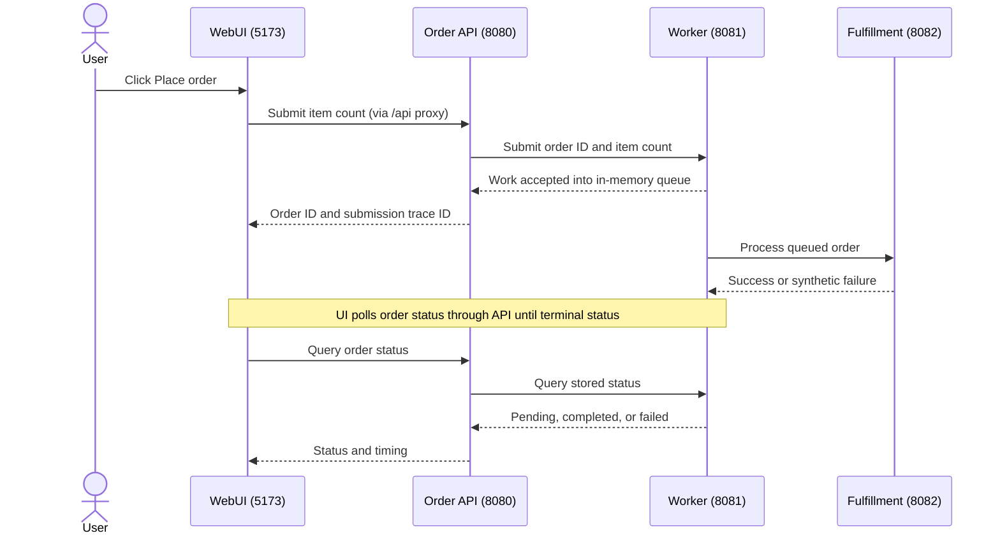

# WebUI guide: what am I looking at?

The **Order Flow WebUI** is at <http://127.0.0.1:5173/>. It lets you submit a
fictional order and see how a small distributed system handles it. Nothing is
purchased, shipped, or sent to a real fulfillment company.

The UI creates activity to observe; **Grafana**, at <http://127.0.0.1:3000/>,
explains that activity through traces, logs, and metrics.

## Reading the initial screen

This layout corresponds to the initial screen in the screenshot:

```text
Order Flow                                      LOCAL / SYNTHETIC

Place an order.
Follow a synthetic order across the API, worker, and fulfillment service.

+---------------------------------+----------------------------------+
| 01 START AN ORDER               | 02 LIVE RESULT             Ready |
|                                 |                                  |
| Items in order                  | No order in this session         |
| [8]  [Place order]              |                                  |
| Allowed range: 1-50             |                                  |
|                                 |                                  |
| Browser > Order API > Worker    | TRACE ID   -                     |
|                       > Fulfillment                                |
+---------------------------------+----------------------------------+
```

| Area | Meaning |
|---|---|
| **Order Flow / Place an order** | The demo's name and main action, not an online shop or a real checkout. |
| **LOCAL / SYNTHETIC** | An environment label indicating this is a local, fictional demo. The dot is not a live health check. |
| **01 START AN ORDER** | The input side: choose how much synthetic work one order represents. |
| **Items in order** | An integer from 1 to 50. The default `8` means eight items in **one** order, not eight orders or eight concurrent users. |
| **Place order** | Submits one order. The button is disabled while submission or processing is pending. |
| **Browser / Order API / Worker / Fulfillment** | A static illustration of the service path, not clickable controls or live progress indicators. |
| **02 LIVE RESULT** | Shows the latest order submitted from this page, not all orders in the system. |
| **Ready / No order in this session** | The page has not submitted an order yet. This is normal, not a failure. The small bars are decorative, not a metric chart. |
| **TRACE ID: -** | No submission trace ID is available yet. An ID appears after the API accepts an order, when tracing is available. |
| **Footer** | Reinforces that the flow uses synthetic data and .NET/OpenTelemetry; these labels are not controls. |

## Try your first order

With the stack running, use PowerShell in the repository root:

```powershell
.\scripts\set-scenario.ps1 -Name healthy
```

Then:

1. Open the WebUI and change **Items in order** to `1`.
2. Click **Place order** once.
3. Expect the status to move through submission and processing to **Completed**.
   The healthy case can finish too quickly to notice every intermediate state.
4. Read the duration, item count, outcome, order ID, and trace ID in the result.
5. To place another order, change the count if desired and click again. The new
   result replaces the previous one; this page is not an order-history browser.

Refreshing or reopening the page resets its local display. It does not cancel
work already accepted by the worker. The worker's queue and order statuses are
in memory and are lost when that service restarts.

## What happens behind the button?



Acceptance means the order was queued, **not** that fulfillment succeeded.
The worker processes queued orders one at a time. While an order waits or runs,
the UI polls its status, scheduling the next pending-status check after 350 ms.

## Reading the live result

### Status badge

| Status | Meaning / what to do |
|---|---|
| **Ready** | No order submitted from this page yet. Choose a count and submit. |
| **Submitting** | The browser is waiting for the API to accept the order. |
| **In progress** | The order is accepted but still queued or processing. Wait; the button stays disabled. |
| **Completed** | The worker received a successful fulfillment response. |
| **Failed** | Processing failed after acceptance. Read the error and keep the IDs for investigation. This is expected when deliberately using the `failing` scenario. |
| **Unavailable** | Submission or status lookup failed, for example because a service could not be reached. This is not the same as a confirmed failed order; accepted work may still be running. |

### Measurements and IDs

| Field | How to interpret it |
|---|---|
| **Order duration** | Displayed in seconds. While pending, it uses the worker-reported elapsed time since submission to the worker. At completion/failure, it switches to browser-measured time from clicking submit until the terminal result is received, including network and polling delays. |
| **Items** | The number of items in this order, not the queue depth. |
| **Outcome** | The backend order status: `pending`, `completed`, or `failed`. |
| **Error text** | Explains a processing or communication failure. It is absent for a normal successful order. |
| **Order ID** | Identifies the business operation. Use it to find the corresponding worker completion/failure log. |
| **Trace ID** | Identifies the submission trace. Use it to find the API-to-worker-to-fulfillment journey in Grafana/Tempo. It is different from the order ID; later status-poll requests are separate requests, not this submission trace. |

The UI duration and Grafana's order-duration metric need not match exactly:
the metric measures time from worker submission to completion, whereas the
final UI measurement includes the browser's round trip and detection delay.
The dashboard's p95 also summarizes multiple observations, not just this order.

## Why change the fulfillment scenario?

The UI deliberately has no scenario selector. From the repository root, use:

```powershell
.\scripts\set-scenario.ps1 -Name slow
```

Replace `slow` with `healthy` or `failing` as needed.

| Scenario | What it demonstrates |
|---|---|
| `healthy` | A successful baseline with approximately 75 ms of synthetic fulfillment delay, plus queueing and other overhead. |
| `slow` | Downstream latency: fulfillment delays for `350 + (itemCount * 100)` ms. Four items add a 750 ms fulfillment delay; total observed time can be longer. |
| `failing` | A deliberate fulfillment HTTP 503 becomes a failed order with error details, rather than a false success. |

Changing the item count does not itself switch the scenario. More items increase
the configured delay in `slow` mode; in `healthy` mode the synthetic delay stays
75 ms. The scenario setting is shared by the fulfillment service, not scoped to
one browser. Avoid changing it while another test is running, and restore
`healthy` afterward.

## From the result to observability

- **Traces: where did the time go?** Copy the trace ID, open Grafana Explore,
  select Tempo, and look up that trace. Inspect the API, worker processing, and
  fulfillment spans.
- **Logs: what happened to this order?** In Grafana Explore, search Loki for the
  order ID to find the worker's completion or failure log.
- **Metrics: is this one order or a wider pattern?** Open the **Order Flow**
  dashboard for duration p95, queue depth, active worker, and outcome counts.
  Custom metrics export every 10 seconds, so allow time and refresh before
  concluding that data is missing.

Simply seeing the initial page proves that the page loads, not that orders or
telemetry work end to end. Continue with
[D-1 and the observability scenarios in the test plan](../../TEST-PLAN.md#d-1-place-a-healthy-order-in-the-ui)
to verify those separately.
